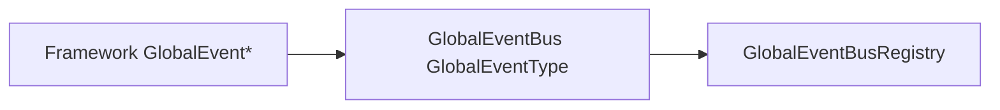

# Architecture: Event

## 개요 (Overview)

*타이틀·베이스가 공유하는 enum-key 전역 이벤트 버스를 UPM asmdef로 분리한 경계와 Reset 계약을 정리한다.*

`com.monet5379.framework-core`의 **`Monet5379.Core.Event`** asmdef는 `GlobalCallback` 델리게이트와 제네릭 `GlobalEventBus<TKey>`를 제공한다. 소비 프로젝트는 게임별 `GlobalEventType` enum과 `GlobalEvent` / `GlobalEvent<T…>` **facade**만 Framework에 두고, 버스 구현·로그 태그는 패키지가 정본이다.

## 책임과 경계 (Responsibilities & Boundaries)

### 포함 범위 (In Scope)

- `Runtime/Event/` — `GlobalCallback`(0~4 인자) · `GlobalEventBus<TKey>` · `GlobalEventBusRegistry` · `CoreEventLogTags`
- `TKey : struct, Enum` — 슬롯 키는 소비 repo enum (`GlobalEventType` 등)
- WeakReference 대상·시그니처 불일치·invoke 예외 처리(기존 Framework 버스와 동일 계약)

### 제외 범위 (Out of Scope)

- **`GlobalEventType` enum** — 타이틀·베이스 Framework
- **`GlobalEvent*` facade** — 호출부 API 유지를 위해 Framework `GlobalEventSystem.cs`에만 둠
- Unity `UnityEvent` · Addressables · 씬 전환 — 소비 Architecture

## 주요 타입과 관계 (Key Types & Relationships)

```text
Monet5379.Core.Event (asmdef)
        references: ConditionalLog.Runtime
        │
        ├── GlobalCallback … GlobalCallback<T,U,V,W>
        ├── GlobalEventBus<TKey>
        └── CoreEventLogTags.Global   ← LogTag("Global", "Event")

소비 Monet5379.Framework
        references: Monet5379.Core.Event
        │
        ├── GlobalEventType (enum)
        └── GlobalEventSystem.cs      ← GlobalEventBus<GlobalEventType> 위임만
```

| 식별자 | 역할 |
|--------|------|
| `GlobalEventBus<TKey>` | 키별 슬롯·콜백 목록. Register/Unregister/Send. 시그니처는 델리게이트 `typeof(TCallback)` |
| `GlobalEventBusRegistry` | 제네릭 버스 static ctor가 `RegisterClear`로 슬롯 Clear 등록. `SubsystemRegistration`에서 등록된 Clear만 호출(목록은 유지) |
| `CoreEventLogTags.Global` | Send·시그니처 불일치 로그. 소비 `GameLogTags`에 동명 태그를 두지 않는다 |



## 흐름 (Flow)

### 런타임 (Runtime)

```text
Register<TCallback>(key, callback)  → 슬롯 없으면 typeof(TCallback)로 생성
                                     → 시그니처 불일치 시 로그 후 무시
Unregister(key, callback)             → 동일 시그니처만 제거
Send(key, …)                         → WeakReference dead entry 제거 후 invoke
                                     → 예외는 LogTag Global로 기록, 나머지 콜백 계속
SubsystemRegistration Reset          → GlobalEventBusRegistry가 등록된 Clear만 호출
```

소비 Framework는 `GlobalEvent.Register` / `Send` / `Unregister` facade가 `GlobalEventBus<GlobalEventType>`에 위임한다. 호출부 시그니처는 v0.2.0 이전과 동일하다.

### 에디터 (Editor)

버스 상태는 플레이 모드 진입·`SubsystemRegistration`마다 비워진다. Edit Mode에서는 사용하지 않는다.

## 불변조건과 주의점 (Invariants & Gotchas)

- **Reset:** `[RuntimeInitializeOnLoadMethod(SubsystemRegistration)]`은 **제네릭 타입**에 붙지 않으므로, non-generic `GlobalEventBusRegistry.Reset`만 사용한다. 새 `TKey` 버스를 추가해도 static ctor가 Clear를 등록하면 SubsystemRegistration에서 함께 비워진다.
- **함께 pin:** `com.monet5379.conditional-log` — asmdef가 `ConditionalLog.Runtime`을 참조한다.
- **태그 이름:** `CoreEventLogTags.Global`과 동일 `LogTag` 이름이면 ConditionalLog 필터 설정이 기존 Framework `GameLogTags.Global`과 호환된다.

## 변경 가이드 (Change Guidelines)

| 변경 | 확인 |
|------|------|
| 새 `TKey` 버스 (다른 enum) | static ctor가 `RegisterClear` 호출하는지 · Registry Reset |
| facade API | 소비 `GlobalEventSystem`만 — 패키지에 게임 enum 넣지 않음 |
| 로그 태그 | `CoreEventLogTags` · 소비 `GameLogTags`에 `Global` 중복 금지 |
| breaking | CHANGELOG · 소비 manifest 태그 |

## 관련 문서 (See also)

- [Packages/com.monet5379.framework-core/README.md](../../Packages/com.monet5379.framework-core/README.md) — 설치 · asmdef 표
- [Architecture_Localization.md](Architecture_Localization.md) — UI 언어 갱신은 `LocalizationContext` (버스와 별도)
- [docs/architecture/README.md](README.md)
- 소비 베이스: [unity-framework Architecture_FrameworkBase](https://github.com/monet5379/unity-framework/blob/main/docs/studio/architecture/Architecture_FrameworkBase.md)
