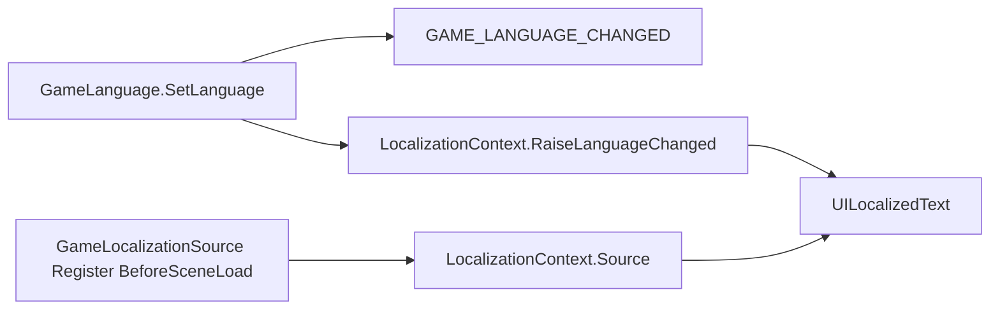

# Architecture: Localization

## 개요 (Overview)

*`Monet5379.Core.Localization` asmdef가 제공하는 언어 enum·`ILocalizationSource`·`UILocalizedText` binding과, 소비 Framework가 등록하는 브리지 계약을 정리한다.*

`com.monet5379.framework-core`의 **`Monet5379.Core.Localization`**은 스튜디오 고정 **`LanguageNames`** enum, **`LocalizationContext`**(정적 Source·`LanguageChanged`), TMP **`UILocalizedText`**·binding·스타일 SO, **`[StringTableKey]`** Inspector( Editor asmdef )를 담는다. JSON 시트·PathMeta·`FontLanguageLabelLoader`·부트 `Apply`는 **소비 repo**가 `ILocalizationSource`로 연결한다 (unity-framework: `GameLocalizationSource`).

## 책임과 경계 (Responsibilities & Boundaries)

### 포함 범위 (In Scope)

- `Runtime/Localization/` — `LanguageNames` · `ILocalizationSource` · `LocalizationContext` · `LocalizationLogTags` · `UILocalizedText` · binding · `LocalizedTextStyleTable` 등
- `Editor/Localization/` — `StringTableKeyDrawer` · `StringTableKeyDropdown` · `StringTableKeyCatalog` (기본 JSON 경로: `Assets/Addressables/JSON/StringUI.json` · `StringDialogue.json`)
- `UILocalizedText`는 **`LocalizationContext.LanguageChanged`**만 구독한다 (`GlobalEvent`에 직접 묶지 않음)

### 제외 범위 (Out of Scope)

- **`GameJsonData` · `StringData` · `FontLanguageLabelLoader` · `AddressableLabels`** — 타이틀·베이스 Framework
- **`GameLanguage.SetLanguage` · PlayerPrefs** — Framework (`GAME_LANGUAGE_CHANGED`는 타이틀 리스너용으로 유지 가능)
- 부트 라벨·`Apply` 시점 — 소비 [Architecture_GameApp](https://github.com/monet5379/unity-framework/blob/main/docs/studio/architecture/Architecture_GameApp.md) (베이스)

## 주요 타입과 관계 (Key Types & Relationships)

```text
Monet5379.Core.Localization (asmdef)
        references: Core.Inspector · Core.Utility · ConditionalLog.Runtime
                    · Unity.TextMeshPro · TmpFontPipeline.Runtime
        │
        ├── LanguageNames (enum, int 직렬화 유지)
        ├── ILocalizationSource
        ├── LocalizationContext  Register · Source · LanguageChanged · RaiseLanguageChanged
        ├── LocalizationLogTags.Font
        └── UILocalizedText + bindings + LocalizedTextStyleTable (SO)

소비 Monet5379.Framework
        references: Monet5379.Core.Localization
        │
        ├── GameLocalizationSource : ILocalizationSource
        └── GameLocalizationSourceBootstrap  [BeforeSceneLoad] Register
```

| 식별자 | 역할 |
|--------|------|
| `ILocalizationSource` | `CurrentLanguage` · `TryGetString` · `FontRoleCatalog` · `StyleTable` · `AcquireFontLanguage` / `ReleaseFontLanguage` |
| `LocalizationContext` | `Register`로 Source 한 개. `LanguageChanged` 이벤트. `SubsystemRegistration`에서 Source·이벤트 초기화 |
| `UILocalizedText` | `RefreshIfLanguageChanged`는 `Source == null`이면 건너뜀. `Source.CurrentLanguage`와 `_lastAppliedLanguage` 비교 |
| `LocalizedTextContentBinding` | `ReloadFromTable` → `Source.TryGetString`. `UseTmpTextWhenStringKeyEmpty`이면 StringKey 없을 때 Awake에 TMP → `_content` 1회 |
| `LocalizedTextFontBinding` | catalog·커스텀 언어 라벨 hold → Source |
| `LocalizedTextTypographyBinding` | `Source.StyleTable` · `LocalizationLogTags.Font` |
| `StringTableKeyCatalog` | Editor 전용. 위 JSON 경로에서 Key 목록 (런타임 `GameJsonData`와 별) |



## 흐름 (Flow)

### 런타임 (Runtime)

```text
BeforeSceneLoad
  GameLocalizationSourceBootstrap → LocalizationContext.Register(source)

UILocalizedText Awake
  TryCaptureTmpTextWhenNoStringKey (UseTmpTextWhenStringKeyEmpty · StringKey empty · _content empty)

UILocalizedText OnEnable
  Font binding OnEnabled (커스텀 언어 라벨 hold)
  XBehaviour → LocalizationContext.LanguageChanged +=
  RefreshIfLanguageChanged
    Source == null → return
    CurrentLanguage == _lastAppliedLanguage → return
    RefreshForLanguage:
      Font binding Apply (TMP text 비운 뒤 폰트)
      Typography binding Apply
      Content ReloadFromTable (Source.TryGetString)
      WriteTo TMP

GameLanguage.SetLanguage (Framework)
  GAME_LANGUAGE_CHANGED (타이틀·폰트 정렬 리스너)
  LocalizationContext.RaiseLanguageChanged → UILocalizedText
```

### 에디터 (Editor)

```text
StringTableKeyCatalog — AssetDatabase로 StringUI.json · StringDialogue.json Key 목록
[StringTableKey] — StringTableKeyDrawer / Dropdown
UILocalizedText partial — OnValidate · AutoSetting (enum 백업 문자열)
```

## 불변조건과 주의점 (Invariants & Gotchas)

- **등록 시점:** `UILocalizedText.OnEnable`은 첫 씬(Splash)에서 `GameApp`보다 먼저일 수 있다. Source는 **`BeforeSceneLoad`**에 등록한다 (베이스 `GameLocalizationSourceBootstrap`).
- **Source null:** 부트 전·테스트에서 Source가 없으면 binding은 no-op. 문자열·폰트 갱신은 등록 이후 `LanguageChanged` 또는 `OnEnabled`에서 다시 시도한다.
- **함께 pin:** `com.monet5379.conditional-log` · `com.monet5379.tmp-font-pipeline` · `com.unity.ugui` (TMP) — asmdef 참조와 manifest pin.
- **언어 enum:** `LanguageNames` 목록 변경은 패키지 버전 bump. int 저장값과 enum 순서를 깨지 않는다.
- **로그 태그:** `LocalizationLogTags.Font`와 소비 `GameLogTags.Font`는 동일 LogTag 이름 → ConditionalLog 필터 공유.

## 변경 가이드 (Change Guidelines)

| 변경 | 확인 |
|------|------|
| `LanguageNames` 멤버 추가·순서 | int 직렬화 · CHANGELOG · 소비 PlayerPrefs·시트 컬럼 |
| binding·`UILocalizedText` API | 이 문서 Flow · unity-framework Localization (부트·PathMeta) |
| `ILocalizationSource` 계약 | 소비 `GameLocalizationSource` · `BeforeSceneLoad` Register |
| `[StringTableKey]` · catalog JSON | README StringTableKey 경로 · AssetsLayout |
| asmdef | TMP · TmpFontPipeline · manifest pin |
| breaking | CHANGELOG · 소비 manifest 태그 |

## 관련 문서 (See also)

- [Architecture_Event.md](Architecture_Event.md) — 전역 이벤트 (언어 UI는 LocalizationContext 우선)
- [Packages/com.monet5379.framework-core/README.md](../../Packages/com.monet5379.framework-core/README.md) — 설치 · asmdef · JSON 경로
- [docs/architecture/README.md](README.md)
- unity-framework [Architecture_Localization.md](https://github.com/monet5379/unity-framework/blob/main/docs/studio/architecture/Architecture_Localization.md) — 부트·PathMeta·`GameJsonData`·라벨 로더
