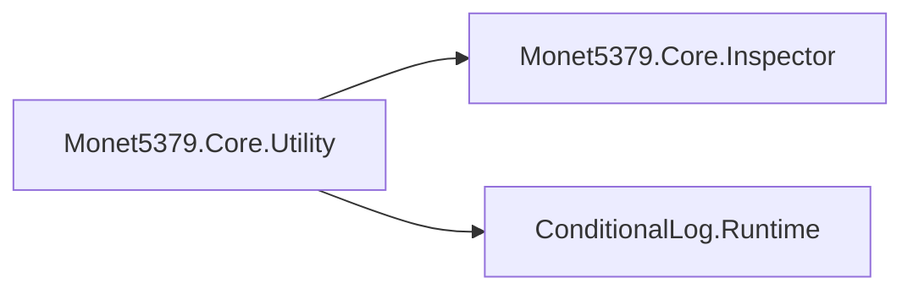

# Architecture: Utility

## 개요 (Overview)

*장르 중립 extension·컬렉션·패턴·변환 유틸을 UPM 한 덩어리로 두는 경계와 asmdef 계약을 정리한다.*

`com.monet5379.framework-core`의 **`Monet5379.Core.Utility`** asmdef는 타이틀·베이스에서 재사용하는 **게임 도메인 밖** 헬퍼만 담는다. Inspector attribute stub(`Monet5379.Core.Inspector`)과 ConditionalLog를 references로 쓴다 — `XBehaviour`가 `[FoldoutGroup]` · `[Button]`을 선언하기 때문이다. Odin-compat 인스펙터 **그리기**는 [Architecture_Inspector.md](Architecture_Inspector.md)가 정본이다.

## 책임과 경계 (Responsibilities & Boundaries)

### 포함 범위 (In Scope)

- `Runtime/Utility/` 전체 — PascalCase 하위 폴더(`Behaviour/` · `Collections/` · `Convert/` · `Extension/` · `Pattern/` 등)
- `InfiniteLoopDetector` — 에디터 `#if UNITY_EDITOR` 루프 감지. Runtime asmdef에 두어 `ComponentEx` 등에서 참조
- `ImageEx` 등 `com.unity.ugui`에 의존하는 extension (`package.json`에 `com.unity.ugui` pin)

### 제외 범위 (Out of Scope)

- **`Utility/Data/`** — JSON 행 검증·게임 Scriptable 전용 트리는 금지. enum·문자열·비트 변환은 **`Utility/Convert/`**(`DataConverter`, `BitConvert`)만
- 타이틀 전용 규칙(`StatEx`, `Gacha`, 도메인 `*Ex` 등) — fork repo
- **`SoundAsset.IsValid`** — 사운드 SO·`SoundNames`에 묶임. 소비 베이스(`unity-framework`)는 `Data/Sound/SoundAssetEx.cs`에 extension으로 둔다
- **DOTween·TMP 결합** (`UITextEx` 등) — 베이스 프레임워크 `Monet5379.Framework`에 남긴다
- Localization · Addressables 경로 · 부트 — 소비 프로젝트 Architecture

## 주요 타입과 관계 (Key Types & Relationships)

```text
Monet5379.Core.Utility (asmdef)
        references: Monet5379.Core.Inspector · ConditionalLog.Runtime · UnityEngine.UI
        │
        ├── Behaviour/          XBehaviour
        ├── Collections/        Deck · ArrayBuilder · ListMultiMap · SetMultiMap · Order
        ├── Convert/            DataConverter · BitConvert
        ├── Extension/          *Ex (MathEx · StringEx · CollectionEx · ComponentEx · …)
        │       GUI/ · String/ · Color/ · Sprite/ · Comparer/ …
        ├── Pattern/            Singleton · SingletonMonoBehaviour
        └── InfiniteLoopDetector
```

| 식별자 | 역할 |
|--------|------|
| `XBehaviour` | `MonoBehaviour` 베이스. `OnStart`·활성화(`IsStarted` 이후)에 `RegisterGlobalEvent`, 비활성·파괴 시 `UnregisterGlobalEvent`. `StartXCoroutine`은 hierarchy 비활성이면 null |
| `CollectionEx` | `T[]` · `List<>`(인덱스 포함)용 `IsValid` extension. **`SoundAsset` overload는 패키지에 없음** |
| `DataConverter` · `BitConvert` | enum·문자열·비트 변환. 소비 프로젝트의 `Scripts/Data/`(SO·매니저)와 **경로·역할 구분** |
| `Deck<T>` · `ArrayBuilder<T>` | 컬렉션 유틸. 장르 중립 용도(오디오 SFX 풀 등) |
| `ComponentEx` · `GizmoEx` · `GUIEx` | 에디터 전용 API는 `#if UNITY_EDITOR` 가드. `using UnityEditor`는 가드 안 |



## 불변조건과 주의점 (Invariants & Gotchas)

- **Utility 범위:** 패키지 `Utility/`는 장르 중립 extension·컬렉션·패턴만. 게임 enum·Addressables 키·JSON 경로를 Utility에 넣지 않는다.
- **Utility vs Data (소비 repo):** 소비 프로젝트 `Scripts/Data/`는 Scriptable·매니저·도메인 Json. 변환기는 패키지 **`Utility/Convert/`**. **`Utility/Data/`는 쓰지 않는다.**
- **참조 방향:** `Monet5379.Core.Utility` → Core.Inspector · ConditionalLog. Utility가 게임 asmdef를 참조하지 않는다. 게임 asmdef는 Core.Utility를 references에 넣어 API를 쓴다.
- **ConditionalLog:** `package.json`에 git 전이 의존으로 넣지 않는다. 소비 `manifest.json`에 `com.monet5379.conditional-log`를 **함께 pin**한다.
- **에디터 API:** `GizmoEx` · `GUIEx` 등 `UnityEditor` 사용 파일은 player 빌드에서 컴파일되도록 `using`·본문을 `UNITY_EDITOR`로 가드한다.
- **fork 전환:** 타이틀에 Utility 사본이 있으면 패키지 pin 전 **제거**(GUID 충돌). diff로 타이틀만의 수정이 있으면 패키지에 반영 후 태그를 올린다.

## 변경 가이드 (Change Guidelines)

| 변경 | 확인 |
|------|------|
| 새 extension·컬렉션 | 장르 중립인지 · `Utility/Data/` 회피 · [Architecture_Inspector.md](Architecture_Inspector.md) attribute 필요 여부 |
| `XBehaviour` · 전역 이벤트 | 소비 repo `GlobalEventSystem` 계약과 시그니처 호환 |
| asmdef references | `Runtime/Utility/Monet5379.Core.Utility.asmdef` · ConditionalLog pin |
| Inspector attribute on Utility 타입 | `Monet5379.Core.Inspector`에 stub 추가 → Editor drawer는 Inspector 문서 경로 |
| breaking API | CHANGELOG · 소비 manifest 태그 |

## 관련 문서 (See also)

- [Architecture_Inspector.md](Architecture_Inspector.md) — attribute · catch-all Editor
- [Packages/com.monet5379.framework-core/README.md](../../Packages/com.monet5379.framework-core/README.md) — 설치 · asmdef 표
- [README.md](../../README.md)
- [docs/architecture/README.md](README.md)
